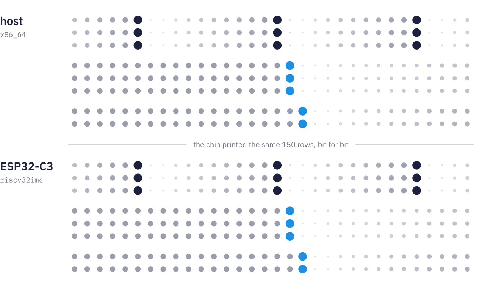
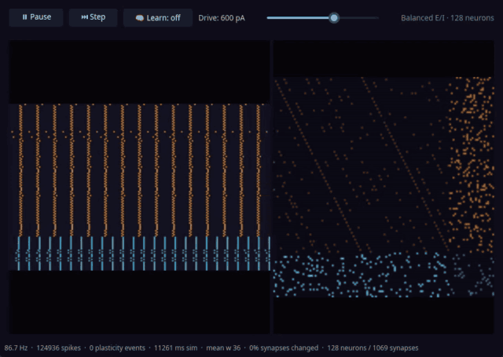

<div align="center">

<picture>
  <source media="(prefers-color-scheme: dark)" srcset="docs/assets/lockup-dark-clear.svg">
  
</picture>

*grésil* (gray-ZEEL), n.: fine hail · *grésiller*, v.: to crackle

### Same graph, same spikes, bit for bit.

Spiking neural networks in `no_std` Rust, i16 fixed point. Export a LIF
graph from snnTorch as `.nir`, and it runs on a microcontroller with the
same spikes as on the host. Checked so far on three targets: x86_64,
riscv64 under QEMU and the ESP32-C3.

[](https://crates.io/crates/gresil)
[](https://docs.rs/gresil)
[](https://gitea.com/gresil-rs/gresil/actions?workflow=ci.yml)
[](LICENSE)

</div>

<picture>
  <source media="(prefers-color-scheme: dark)" srcset="docs/assets/hero-dark.svg">
  
</picture>

The same eight neurons, 1 ms a step, on an x86_64 host and on an
ESP32-C3. A dot's size is the membrane's charge toward threshold, a full
dot is a spike, and the blue dots are spikes passed down the layers. The
chip printed the same 150 rows, every spike and every membrane value,
bit for bit. The picture is drawn from the frozen trace and the board's
log of that run, and the script that draws it stops if they differ.

## Run your graph on the chip

Export your graph as `.nir`, plug in an ESP32-C3, and run:

```console
$ git clone https://gitea.com/gresil-rs/gresil && cd gresil
$ firmware/esp32c3/stranger.sh run your_graph.nir
…
15 cases, 0 red
```

One command converts the graph in pure Rust, builds and flashes the
firmware, replays your graph and fourteen frozen traces, and diffs every
row the board prints against the host's. The last line is the verdict.
So far the board has run an snnTorch graph.

No board? `firmware/esp32c3/stranger.sh build your_graph.nir` stops
after the build and writes the host's trace.
The [board's page](firmware/esp32c3/README.md) lists the tools:
`espflash` 4, the `riscv32imc-unknown-none-elf` target and `llvm-tools`.

## Use it in Rust

```toml
[dependencies]
gresil = "0.1.0-alpha.9"
```

```rust
use gresil::{LIFNeuron, NeuronType, VoltageResolution};

let mut neuron = LIFNeuron::new(
    0,
    NeuronType::Excitatory,
    VoltageResolution::CentiMillivolt,
);

let mut spikes = 0u32;
let mut first_spike_step = None;

for step in 0..10_000u32 {
    neuron.decay_adaptation_current();
    if neuron.integrate_and_fire(
        160,          // input current, pA
        1_000,        // time step, µs
        step * 1_000, // simulation time, µs
    ) {
        spikes += 1;
        first_spike_step.get_or_insert(step);
    }
}

assert_eq!(spikes, 147);
assert_eq!(first_spike_step, Some(55));
```

This is the neuron the board runs, and the board prints the same
`147 spikes, first spike step 55`. Everything here is `no_std`:
`default-features = false` builds it for the chip.

Four examples to copy from, in `crates/gresil/examples/`: `stranger`
steps a graph on the host, `freeze` writes it as the arrays a board
compiles, `board` steps those arrays without `std`, and `learner` runs
STDP by hand without `std`. CI tests all four and checks the two
`no_std` ones for the C3's target. Start with
`cargo run -p gresil --example stranger`.

## What's inside

- **gresil**, the library: LIF neurons, synapses, a network that steps
  in fixed arrays with no heap, and NIR import and export as JSON. i16
  fixed point, no float in the hot path, no runtime dependency.
- **gresil-nir2json**, the converter: reads a `.nir` file in pure Rust
  and writes the library's JSON, or, with `--freeze`, the Rust arrays
  the firmware compiles. A static Linux binary is on the release page.
- **gresil-scope**, the microscope: a Slint app that runs the library
  live, the spike raster on the left and the weight map on the right.
- **firmware/esp32c3**, the board: it replays the host's frozen traces
  over serial, and `stranger.sh` puts your graph in its slot.

<p align="center"></p>

<p align="center">gresil-scope at its defaults: 128 neurons in a balanced excitatory and inhibitory network, a 600 pA drive. At this drive the network fires in volleys.</p>

## How it is checked

- **Every target:** the frozen traces replay exactly on all three: in
  CI, under QEMU at each release, and on the board. The QEMU replay is
  yours to run: `proofs/qemu-trace-replay/build.sh`, with
  `qemu-system-riscv64` and the `riscv64gc-unknown-none-elf` target
  installed.
- `FixedNetwork::step` has no panic path, proven at link time on every
  commit.
- The library has no dependency, and its default build forbids
  `unsafe`.
- A network fits on the C3 when `44·N + 6·S ≤ 262,144` bytes (N
  neurons, S synapses). Both ends ran on the board, row for row: 5,957
  neurons in one layer, and two layers of 201 neurons wired all to all.
- The `no_std` builds, the minimum Rust version (1.92), clippy, rustdoc
  and the doctests all run in CI.

## Limits

- LIF neurons only. The converter takes `Input`, `LIF`, `Linear` and
  `Output` nodes, and `Affine` under `--sim-units`. Anything else, such
  as `Conv`, is refused by name.
- Against snnTorch itself, the spikes are close, not identical. The
  converter's parity test runs snnTorch's own exports with zero reset,
  at 0.1 ms steps, on constant input, random input and a trained model,
  and names and pins every miss; the trained model gives snnTorch's
  class on all ten test digits. The limits behind the misses are in
  [the converter's README](crates/gresil-nir2json/README.md#what-converts-what-refuses--and-why).
- On the ESP32-C3, the network must fit the bar above. A network near
  the bar replays exactly, but slower than real time.
- Learning (STDP) sits behind the `unstable-stdp` feature, off by
  default. The network on the chip does not learn.
- The board's capture and diff are Python 3 scripts, standard library
  only, for now.
- Pre-1.0: the API still moves.

## Status

`0.1.0-alpha.9` on crates.io, the first release named `gresil`
(alpha.8 and earlier: `neuralos-snn`). 0.1.0 is tagged when the release
checklist in [docs/ROADMAP.md](docs/ROADMAP.md) holds on the final tree,
not on a date.

Built with AI assistance. All design decisions, merges and releases are
the author's.

## More

- **Documentation:** the API on [docs.rs](https://docs.rs/gresil), open
  work in [docs/ROADMAP.md](docs/ROADMAP.md), the direction in
  [docs/VISION.md](docs/VISION.md).
- **Repository:** [AGENTS.md](AGENTS.md) has the layout and every gate
  CI runs. `ISA.md` is the research ledger behind the paper.
- **Contributing:** [issues](https://gitea.com/gresil-rs/gresil/issues)
  are welcome, on Gitea. Pull requests are not accepted for now.
- **History:** this repository was NeuralOS v2 until the rename. Its
  closed research chapter, the ternary bridge, is recorded in a paper
  ([DOI 10.5281/zenodo.22064018](https://doi.org/10.5281/zenodo.22064018))
  and a source archive
  ([DOI 10.5281/zenodo.22064020](https://doi.org/10.5281/zenodo.22064020)).

## License

AGPL-3.0-or-later. Copyright (C) 2026 philo-the-dendron. The notice is
in [COPYRIGHT](COPYRIGHT), the license text in [LICENSE](LICENSE).
